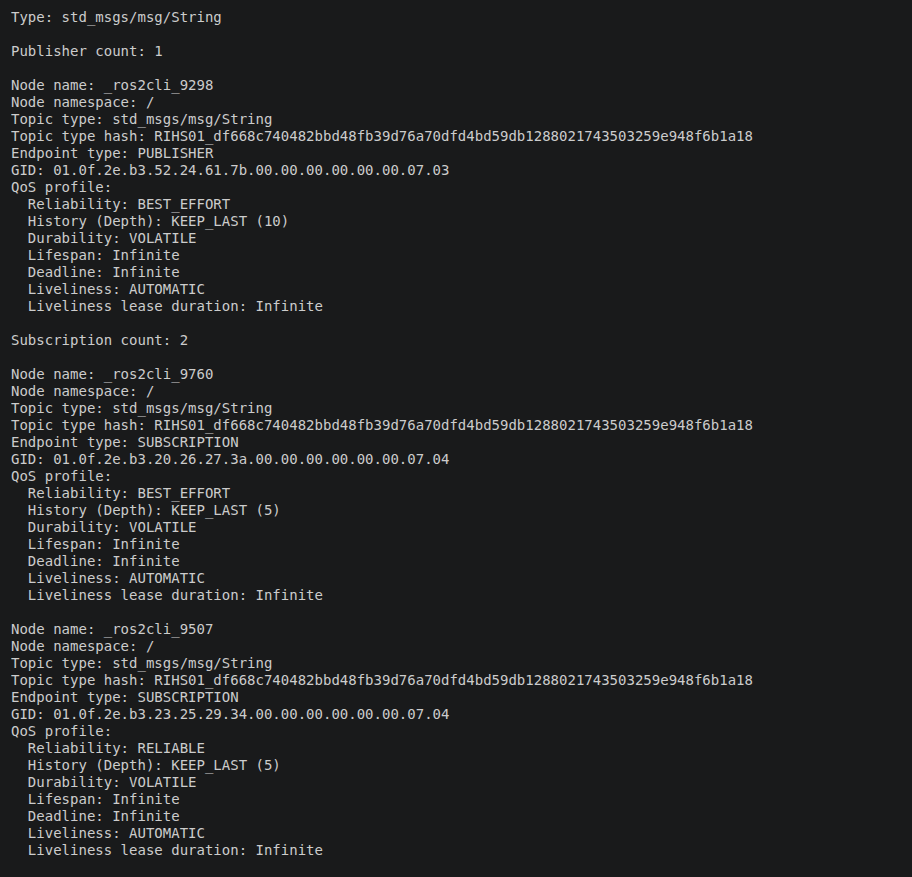

## Q1: QoS (Quality of Service) Compatibility Matrix & Verification

**Question:**
Which Publisher/Subscriber QoS combinations match? Build the full compatibility table for Reliability, Durability, History/Depth, Deadline, Lifespan, and Liveliness, and verify two cells with `ros2 topic info -v`.

**Answer:**
ROS 2 (via DDS) enforces a **Request vs. Offered (RxO)** compatibility model: the Publisher *offers* a level of guarantee, and the Subscriber *requests* a minimum guarantee. A connection is established only if what is offered is **at least as strict** as what is requested.

### 1. Reliability
| Publisher (Offered) | Subscriber (Requested) | Match? | Notes |
| :--- | :--- | :--- | :--- |
| `RELIABLE` | `RELIABLE` | Yes | Guaranteed delivery (retransmissions enabled). |
| `RELIABLE` | `BEST_EFFORT` | Yes | Publisher offers stronger guarantee than needed. |
| `BEST_EFFORT` | `BEST_EFFORT` | Yes | Fire-and-forget (standard for high-rate sensors / PX4 `/fmu/out/*`). |
| `BEST_EFFORT` | `RELIABLE` | **No** | Classic PX4 trap: Publisher refuses to buffer/retransmit packets. |

### 2. Durability
| Publisher (Offered) | Subscriber (Requested) | Match? | Notes |
| :--- | :--- | :--- | :--- |
| `TRANSIENT_LOCAL` | `TRANSIENT_LOCAL` | Yes | Late-joining Subscribers receive cached historical messages. |
| `TRANSIENT_LOCAL` | `VOLATILE` | Yes | Subscriber simply ignores historical cache. |
| `VOLATILE` | `VOLATILE` | Yes | Only live messages published after matching are delivered. |
| `VOLATILE` | `TRANSIENT_LOCAL` | **No** | Publisher does not retain past samples for late joiners. |

### 3. History & Depth (`KEEP_LAST(N)` / `KEEP_ALL`)
* **Matching rule:** **Always compatible.** History and Depth are strictly local endpoint buffering policies and do **not** prevent DDS discovery or matching.
* **Practical note:** Although endpoints always match, setting an overly small `depth` with `BEST_EFFORT` (or a slow subscriber) causes silent message drops in the local queue.

### 4. Deadline
| Condition | Match? | Notes |
| :--- | :--- | :--- |
| $\text{Pub Deadline} \le \text{Sub Deadline}$ | Yes | Publisher commits to updating at least as frequently as Subscriber requires. |
| $\text{Pub Deadline} > \text{Sub Deadline}$ | **No** | Includes Pub = `Infinite` (default) vs. Sub = finite (e.g., `100 ms`). |

### 5. Lifespan
* **Matching rule:** **Always compatible.** Lifespan is a publisher-side expiration policy controlling how long a sample remains valid in the middleware before being discarded (useful to prevent acting on stale telemetry). It does not participate in RxO matching.

### 6. Liveliness (Kind & Lease Duration)
* **Liveliness Kind:** `MANUAL_BY_TOPIC` is stricter than `AUTOMATIC`.

| Publisher (Offered) | Subscriber (Requested) | Match? |
| :--- | :--- | :--- |
| `MANUAL_BY_TOPIC` | `MANUAL_BY_TOPIC` | Yes |
| `MANUAL_BY_TOPIC` | `AUTOMATIC` | Yes |
| `AUTOMATIC` | `AUTOMATIC` | Yes |
| `AUTOMATIC` | `MANUAL_BY_TOPIC` | **No** |

* **Lease Duration:** Follows the same rule as Deadline: compatible if and only if $\text{Pub Lease Duration} \le \text{Sub Lease Duration}$.

### Local Verification with `ros2 topic info -v`
To empirically verify two cells (e.g., `BEST_EFFORT` <-> `RELIABLE` failure vs. `BEST_EFFORT` <-> `BEST_EFFORT` success):

```bash
# Terminal 1: Start a Best Effort publisher (mimics PX4 /fmu/out/*)
ros2 topic pub /qos_test std_msgs/msg/String "{data: 'ping'}" --qos-reliability best_effort

# Terminal 2 (Case A - Incompatible): Start a Reliable subscriber
ros2 topic echo /qos_test --qos-reliability reliable

# Terminal 2 (Case B - Compatible): Start a Best Effort subscriber
ros2 topic echo /qos_test --qos-reliability best_effort

# Terminal 3: Inspect endpoints and offered/requested QoS profiles side-by-side
ros2 topic info /qos_test -v
```

<!--
Source - https://stackoverflow.com/q/41604263
Posted by zjffdu, modified by community. See post 'Timeline' for change history
Retrieved 2026-11-19, License - CC BY-SA 4.0
-->



---

## Q2: Incompatible QoS Symptoms & Diagnostics

**Question:**
What does a "no data received" symptom look like when QoS is incompatible, and which tool tells you why (incompatible QoS events/warnings)?

**Answer:**
* **Symptom:** A **silent communication failure**. Both nodes start without crashing, `ros2 topic list` lists the topic normally, and `ros2 topic info /topic` reports `Publisher count: 1` and `Subscription count: 1`. However, the subscriber's callback never fires and `ros2 topic echo` hangs indefinitely without printing data.
* **Diagnostic Tools & Mechanisms:**
  1. **`ros2 topic info <topic> -v`**: Prints the full QoS profile of every publisher and subscriber on that topic, making Reliability, Durability, Deadline, or Liveliness mismatches immediately visible.
  2. **RMW / `rclcpp` Warnings**: By default in ROS 2 Humble+, `rclcpp` and `ros2 topic echo` emit a runtime warning when an incompatible peer is discovered:
     `[WARN] New publisher discovered on topic '...', offering incompatible QoS. No messages will be sent to it. Last incompatible policy: RELIABILITY_QOS_POLICY`
  3. **Programmatic QoS Event Callbacks**: Production UAV nodes can register `incompatible_qos_callback` inside `rclcpp::SubscriptionOptions::event_callbacks` (and `PublisherOptions`) or call `rclcpp::qos_check_compatible()` to trigger structured diagnostics/alerts on mismatch.

---

## Q3: Discovery Without a Master (Participants, Endpoints, Wi-Fi & Docker Pitfalls)

**Question:**
How does discovery work without a master (participants, endpoints, multicast vs. unicast), and what breaks it on Wi-Fi and in Docker?

**Answer:**
ROS 2 replaces ROS 1's centralized `roscore` with the **RTPS (Real-Time Publish Subscribe)** discovery protocol embedded in DDS, which operates in two stages:

1. **SPDP (Simple Participant Discovery Protocol — Participants via Multicast):**
   When a ROS 2 process starts, it creates a DDS *DomainParticipant* and broadcasts periodic announcement packets over **UDP Multicast** (typically `239.255.0.1` on a domain-specific port). Other participants listening on the same domain receive the multicast announcement and learn each other's unicast IP/port locators.
2. **SEDP (Simple Endpoint Discovery Protocol — Endpoints via Unicast):**
   Once participants know each other, they exchange metadata about their individual *Endpoints* (DataWriters/Publishers and DataReaders/Subscribers: topic names, message types, and QoS policies) over reliable **UDP Unicast** channels. If topic, type, and QoS match, user data flows directly peer-to-peer (over Unicast or Shared Memory on the same host).

### What Breaks Discovery on Wi-Fi
* **Multicast blocking/throttling:** Many access points and corporate/field routers drop UDP multicast packets, enable AP/client isolation, or transmit multicast at the lowest Wi-Fi basic data rate, causing SPDP packets to be lost.
* **Packet loss during SEDP:** High jitter or loss stalls endpoint matching.
* **Mitigation:** Use **Fast DDS Discovery Server** (client-server unicast discovery) or configure static unicast peer lists in XML profiles.

### What Breaks Discovery in Docker
* **Bridge network isolation:** Docker's default `bridge` network puts containers in separate subnets/network namespaces, blocking UDP multicast across hosts (and across non-shared Docker networks).
* **Shared Memory (SHM) trap (Fast DDS):** Even when using `--network=host`, two containers on the same Linux machine see the same host IP and may negotiate Fast DDS Shared Memory transport. If they do not share `/dev/shm` (i.e., missing `--ipc=host` or bind-mounting `/dev/shm`), discovery succeeds via network sockets, but **data delivery silently fails** because each container has an isolated `/dev/shm` namespace.
* **Host firewalls:** `ufw` or `iptables` blocking DDS discovery/user UDP ports.

---

## Q4: Network Isolation (`ROS_DOMAIN_ID` & `ROS_LOCALHOST_ONLY`)

**Question:**
`ROS_DOMAIN_ID` and `ROS_LOCALHOST_ONLY`: what do they isolate?

**Answer:**
* **`ROS_DOMAIN_ID` (Logical Domain Isolation):**
  DDS uses this integer (`0` to `232`, with `0`–`101` recommended on Linux to avoid colliding with ephemeral ports `32768`–`60999`) as a deterministic mathematical offset to compute UDP multicast and unicast ports (e.g., $\text{port} = PB + DG \times \text{domain\_id} + \dots$, where $PB = 7400$ and $DG = 250$).
  * *What it isolates:* Groups of nodes sharing the same physical LAN/Wi-Fi. If two drone teams leave `ROS_DOMAIN_ID=0` on the same field network, their traffic collides (**cross-talk**), potentially sending Team B's flight commands to Team A's drone. Assigning distinct Domain IDs cleanly partitions them while still allowing multi-machine communication within each team.
* **`ROS_LOCALHOST_ONLY=1` (Host-Level Physical Isolation):**
  Restricts all DDS discovery and data traffic strictly to the local loopback interface (`127.0.0.1` / `lo`). No DDS packets are sent out through physical network cards (Wi-Fi/Ethernet).
  * *What it isolates:* The entire machine from the outside network, even if another PC on the same router uses the exact same `ROS_DOMAIN_ID`. Ideal for local SITL testing and CI runners. *(Note: in ROS 2 Jazzy+, this is superseded by `ROS_AUTOMATIC_DISCOVERY_RANGE=LOCALHOST`.)*

---

## Q5: Single-Threaded Executor Starvation

**Question:**
In a single-threaded executor, can a long callback starve a timer? Show it with a 10-line experiment.

**Answer:**
**Yes.** A `SingleThreadedExecutor` pops and executes callbacks sequentially on one thread. If any callback performs a blocking operation (e.g., synchronous disk I/O, a blocking service call, or `sleep_for`), the executor thread cannot return to poll the wait set. Safety watchdogs, control timers, and incoming sensor callbacks are starved until the blocking call returns, violating real-time constraints.

### Minimal Experiment (~10 lines of core logic)
A fast `100 ms` safety timer is paired with a slow `1 s` timer that blocks for `2 s`. Instead of firing every `100 ms`, the fast timer freezes for the full `2000 ms` window:

```cpp
auto node = std::make_shared<rclcpp::Node>("starvation_demo");
auto last = std::chrono::steady_clock::now();

auto fast_timer = node->create_wall_timer(100ms, [&]() {
    auto now = std::chrono::steady_clock::now();
    auto dt_ms = std::chrono::duration_cast<std::chrono::milliseconds>(now - last).count();
    last = now;
    RCLCPP_INFO(node->get_logger(), "Fast timer dt: %ld ms (expected ~100 ms)", dt_ms);
});

auto blocker_timer = node->create_wall_timer(1000ms, [&]() {
    RCLCPP_WARN(node->get_logger(), "Blocking executor thread for 2000 ms...");
    std::this_thread::sleep_for(2000ms); // Starves fast_timer!
});
rclcpp::spin(node); // Uses SingleThreadedExecutor by default
```

**Expected result:** `fast_timer` logs `~100 ms` until `blocker_timer` triggers, then stalls completely and prints `dt: ~2000 ms`.
**Fix:** Offload blocking work to a dedicated worker thread, use asynchronous APIs, or use a `MultiThreadedExecutor` with separate `CallbackGroup`s.

---

## Q6: `shared_from_this()` in Constructors & `[this]` Lambda Captures

**Question:**
Why can't you call `shared_from_this()` in a constructor, and why is capturing `this` in a lambda stored by the node usually safe, whereas in a detached thread it is not?

**Answer:**
### 1. Why `shared_from_this()` fails in a constructor
`rclcpp::Node` inherits from `std::enable_shared_from_this<Node>`, which maintains an internal `std::weak_ptr` to the owning control block. When you construct a node with `std::make_shared<MyNode>()`:
1. Memory is allocated and `MyNode::MyNode()` executes **first**.
2. Only **after** the constructor returns does `std::shared_ptr` initialize the internal `weak_ptr`.

Calling `shared_from_this()` inside the constructor attempts to lock an uninitialized/expired `weak_ptr`, throwing `std::bad_weak_ptr`.
* **Workaround:** Use a post-construction `init()` method or a one-shot timer that fires after the node is owned by a `shared_ptr`.

### 2. Capturing `[this]` in a Node-owned Lambda vs. a Detached Thread
* **Stored by the node (e.g., timer or subscription callback):** Usually safe because the timer/subscription is a **member owned by the node**. During orderly shutdown and destruction, member handles are destroyed before the node's memory is reclaimed, so the executor will not invoke the callback on a destroyed object.
* **Passed to a detached `std::thread`:** **Unsafe (Undefined Behavior / Use-After-Free).** A detached thread's lifetime is completely decoupled from the node. If the node is destroyed (e.g., on `SIGINT`), `this` becomes a dangling pointer (violating SEI CERT EXP54-CPP).
  * **Fix:** Keep the thread joinable and call `thread.join()` in the destructor, or capture `weak_from_this()` (post-construction) and `.lock()` it inside the thread before accessing members.

---

## Q7: Underlay vs. Overlay & `rosidl` Code Generation

**Question:**
What is the difference between underlay and overlay, and what does `rosidl` generate from a `.msg`?

**Answer:**
### 1. Underlay vs. Overlay
* **Underlay:** The base ROS 2 installation (e.g., `/opt/ros/humble/setup.bash`), providing core middleware, `rclcpp`, and standard message definitions. It is sourced first.
* **Overlay:** A user workspace (e.g., `uav_ws/install/setup.bash`) built on top of the underlay. Sourcing the overlay **prepends** its paths to environment variables (`AMENT_PREFIX_PATH`, `LD_LIBRARY_PATH`, `PATH`, `PYTHONPATH`). Custom packages become discoverable and can even shadow/override packages of the same name in the underlay without modifying system files.

### 2. What `rosidl` Generates from a `.msg` File
When `rosidl_generate_interfaces()` processes a `.msg` file (such as `DroneTelemetry.msg`), it converts it into a standardized `.idl` intermediate representation and generates:
1. **Language Bindings (Data Structures):**
   * **C++ headers** (`drone_telemetry.hpp`): strongly typed struct, builder helpers, and smart-pointer aliases (`SharedPtr`, `ConstSharedPtr`, `UniquePtr`).
   * **C headers** (`drone_telemetry__struct.h` and `__functions.h`): raw C structs plus memory allocation/initialization/finalization functions.
   * **Python modules**: Python classes with `__slots__` and type-checked properties.
2. **Type Support Libraries:**
   * Serialization/deserialization glue for each RMW/DDS vendor (e.g., `rosidl_typesupport_fastrtps_cpp` for CDR wire encoding).
   * Runtime introspection metadata (`rosidl_typesupport_introspection_cpp`) used by dynamic tools like `ros2 topic echo` and `rosbag2`.

---

## Q8: `std_msgs/Header.stamp` & ROS 2 Time Sources

**Question:**
Why does `std_msgs/Header.stamp` matter, and what are the three time sources you may meet (system, steady, ROS/sim time)?

**Answer:**
### 1. Why `std_msgs/Header.stamp` Matters
`Header.stamp` records the **exact time of physical data acquisition** (when the sensor sampled the world), not when the subscriber's callback eventually received the message over DDS/Wi-Fi. This is critical in UAV stacks for:
* **TF2 coordinate transforms:** Looking up where the drone was at the exact millisecond a camera frame was captured (preventing extrapolation errors during precision landing).
* **Multi-sensor fusion & synchronization:** Aligning delayed measurements (e.g., EKF2 delayed fusion horizon, `message_filters`).
* **Latency & staleness checks:** Computing transport delay and discarding outdated telemetry/setpoints before they destabilize a control loop.

### 2. The Three Time Sources in ROS 2
| Time Source | ROS 2 Enum / C++ Equivalent | Behavior | When to Use in UAV Software |
| :--- | :--- | :--- | :--- |
| **System Time** | `RCL_SYSTEM_TIME` / `std::chrono::system_clock` | Wall-clock UTC epoch. **Non-monotonic**: can jump forward/backward due to NTP/chrony sync. | Human-readable logs, correlating with external servers. **Never** use for control-loop $dt$. |
| **Steady Time** | `RCL_STEADY_TIME` / `std::chrono::steady_clock` | Hardware monotonic clock; guaranteed never to decrease. | Measuring elapsed intervals, PID $dt$, link-loss watchdogs, and timeouts on real hardware. |
| **ROS / Sim Time** | `RCL_ROS_TIME` / `node->now()` | Uses `RCL_SYSTEM_TIME` when `use_sim_time=false`, or reads the `/clock` topic when `use_sim_time=true`. | Message `Header.stamp`, TF2 lookups, Gazebo lockstep (including faster-than-real-time), and `ros2 bag play --clock` replay. |

* **Key Pitfall:** Never subtract a `steady_clock` timestamp from a `node->now()` (`RCL_ROS_TIME`) timestamp—in simulation (`use_sim_time=true`), `/clock` starts at `0.0 s`, whereas `steady_clock` reflects host uptime, causing massive bogus durations and TF extrapolation failures.